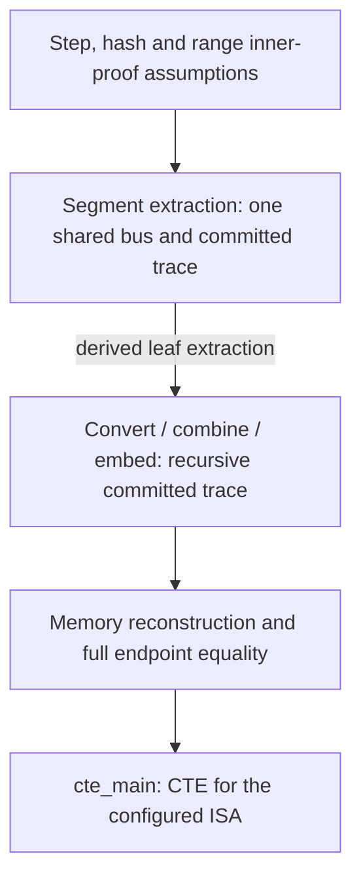

# recursion-topology-fv

Lean 4 proofs that the relations in a simplified recursive zero-knowledge
virtual machine (zkVM) architecture compose into a full execution trace.

A zkVM splits execution into segments and joins their proofs recursively.
Individual proof-system guarantees do not establish that the segments meet at
the same states, use consistent memory, or check the same deferred operations.
This repository verifies those composition obligations for the
[VanillaVM architecture](docs/vanillaVM.pdf).

> **v1 result:** under explicit perfect extraction and commitment assumptions,
> every accepted final proof yields a full-memory trace of the fixed number of
> steps, with the claimed initial and final states, satisfying the configured
> representative ISA relation at every step.
>
> This is a conditional architecture theorem. v1 does not establish the
> security of a deployed zkVM, a concrete bit-security bound, or correspondence
> with the RISC-V Sail model.

The result is [`VanillaVM.System.cte_main`](recursion-topology-fv/VMs/VanillaVM/VanillaVM.lean).
The long-term goal is an end-to-end security claim for a concrete zkVM; the
[scope ledger](docs/SCOPE.md) identifies the remaining semantic,
cryptographic, and implementation bridges. This effort corresponds to the
[W3 deliverable](https://zkevm.ethereum.foundation/blog/cryptography-research-update)
from the zkVM security sprint.

## Start here

| Question | Read |
|---|---|
| What is proved, and how do the pieces compose? | [Proof map and core definitions](docs/PROOF_MAP.md) |
| Which assumptions and trusted components does it rely on? | [Trust and assumption ledger](docs/PROOF_MAP.md#trust-and-assumption-ledger) |
| What is abstracted, absent, or requires a different model? | [Scope and refinement boundaries](docs/SCOPE.md) |
| How do the paper and Lean each approximate a real zkVM? | [Model-to-reality ledger](docs/CORRESPONDENCE.md#model-to-reality-ledger) |
| What do the perfect cryptographic predicates mean? | [Idealization notes](IDEALIZATION.md) |
| Which parts have computational implementations or classical dependencies? | [Computability and execution boundaries](docs/COMPUTABILITY.md) |
| How do the Lean statements relate to the paper? | [Correspondence matrix](docs/CORRESPONDENCE.md) and [math companion](docs/math-companion.md) |

## Correct-trace extractability

*Correct-trace extractability* (CTE) says that one extractor maps every accepted
statement/proof pair to a valid execution trace and, where applicable, a private
input. Validity checks both endpoints and every transition up to the fixed step
count `T`. The trace is represented by a function `ℕ → State`, whose values
after `T` are irrelevant.

The [actual definition](recursion-topology-fv/Specification/Cte.lean) is:

```lean
def CTE : Prop :=
  ∃ E : V.Stmt → V.Proof → V.PrivInput × (ℕ → V.State),
    ∀ (x : V.Stmt) (p : V.Proof),
      V.verify x p → V.TraceValid x (E x p).1 (E x p).2
```

For the assembled VanillaVM, the statement gives full initial and final states,
the private-input type is `Unit`, and the final verifier receives their
committed boundaries. The step predicate is `ISA.System.stepPlain`: five
operation classes with parameterized non-memory semantics, not decoded RISC-V.

The extractor is an unrestricted mathematical function. Its existence does not
establish computability, efficient knowledge extraction, a failure probability,
or zero knowledge. The main theorem assumes eight proof-system extraction
properties, bus-hash injectivity, and three memory-commitment properties; the
[proof map](docs/PROOF_MAP.md) shows each use and the derived leaf guarantee.

## Proof flow



Arrows show proof flow, not all premises or module imports. Each stage has
explicit assumptions listed in the [detailed map](docs/PROOF_MAP.md).

## Project layout

| Path | Role |
|---|---|
| `Preliminaries/` | Relations, argument/extractor and commitment interfaces; trace concatenation |
| `Specification/` | Abstract `ZkVM`, trace validity and CTE |
| `VMs/State.lean`, `Memory.lean`, `ISA.lean` | State representation, memory reconstruction and representative instruction relations |
| `VMs/Bus.lean`, `Step.lean` | Segment bus extraction and step-interface packaging |
| `VMs/MultiStep/` | Recursive convert/combine/embed composition over an abstract leaf proof system |
| `VMs/VanillaVM/` | Assembly deriving leaf extraction from the bus theorem |
| `VMs/NonDeterministic/` | Private-input wrapper for an abstract base VM |
| `*Sanity.lean` | Accepting models and negative examples |

Lean paths above are relative to `recursion-topology-fv/`.
The [source map](docs/PROOF_MAP.md#source-map) gives links and a reading order.

For a simpler introduction before studying recursive composition, see
[`TwoStep`](recursion-topology-fv/VMs/TwoStep/TwoStep.lean). It illustrates flat
two-layer proof composition and memory reconstruction; it is not part of the
main MultiStep proof flow. Its name refers to proof layers, not guest instructions.

## Build and check

```bash
lake exe cache get
lake build
python3 scripts/ci_checks.py --self-test \
  --check-correspondence --check-axioms --check-hygiene
```

Use the toolchain in [`lean-toolchain`](lean-toolchain) and dependencies pinned
in [`lake-manifest.json`](lake-manifest.json). CI builds every discovered project
module, checks selected correspondence names, and checks headline and
whole-project axiom dependencies against `{propext, Classical.choice, Quot.sound}`.
See [what these checks establish](docs/PROOF_MAP.md#validation-boundary).

## License

Apache License 2.0. See [LICENSE](LICENSE).
