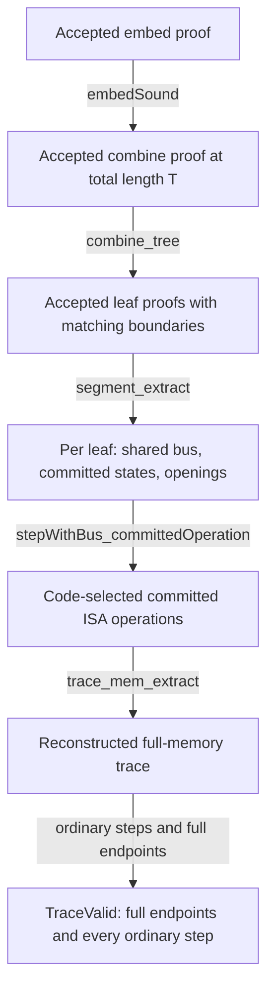
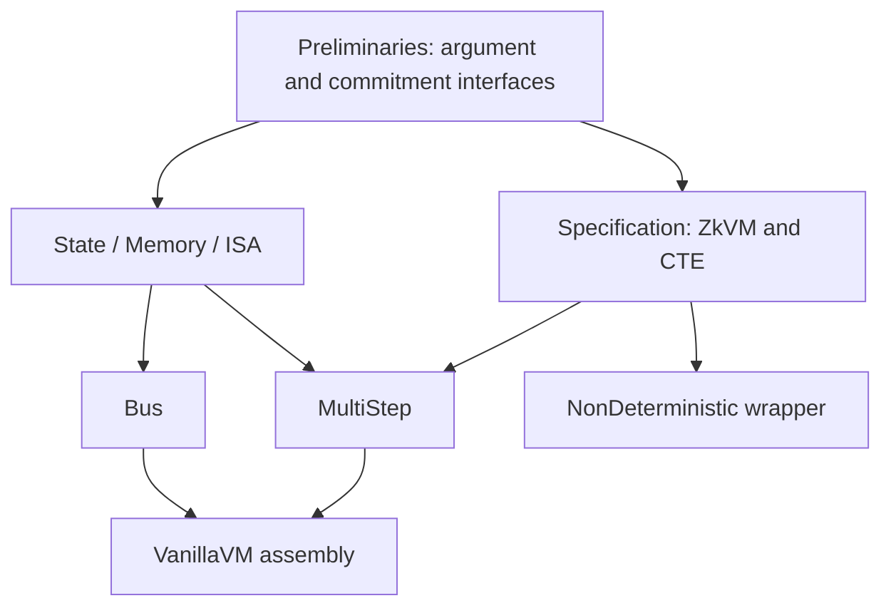

# Proof map

This is a reading guide to the current conditional theorem, with links to its
definitions, assumptions, and principal proof steps. The
[math companion](math-companion.md) supplies fuller mathematical statements;
the [correspondence guide](CORRESPONDENCE.md) distinguishes paper and Lean
idealizations before its paper-item fidelity matrix.
The [scope ledger](SCOPE.md) tracks the boundary to concrete zkVM verification.

## The theorem to read first

In [`VMs/VanillaVM/VanillaVM.lean`](../recursion-topology-fv/VMs/VanillaVM/VanillaVM.lean),
inside `VanillaZkVM.VanillaVM.System`:

```lean
theorem cte_main (h : sys.Assumptions) : sys.toZkVM.CTE
```

Fix a system with segment length `n > 0`, `n ∣ T`, and `T ≥ 2 * n`.
Under `sys.Assumptions`, acceptance of a final proof for full states `S0, ST`
implies that the CTE extractor returns a trace `tr` satisfying:

```text
tr 0 = S0
tr T = ST
for every i < T, sys.segment.isa.stepPlain (tr i) (tr (i + 1))
```

These equalities include full memory, not just memory commitments.
`sys.toZkVM.verify` passes committed versions of the supplied boundaries to
the configured embed verifier. Neither that verifier nor the step predicate
is identified with a deployed implementation here.

## Core definitions

| Definition | Meaning in this repository | Source |
|---|---|---|
| `Relation` | Statement and witness types with a membership predicate `rel x w` | [ArgumentSystem.lean](../recursion-topology-fv/Preliminaries/ArgumentSystem.lean) |
| `ArgumentSystem` | Proof type and `Prop`-valued verifier for a relation; no prover or algorithmic/decidability requirement | [ArgumentSystem.lean](../recursion-topology-fv/Preliminaries/ArgumentSystem.lean) |
| `Extractor` / `KnowledgeSound` | One unrestricted witness function correct on every accepted pair; no time or error bound | [ArgumentSystem.lean](../recursion-topology-fv/Preliminaries/ArgumentSystem.lean) |
| `ZkVM` | States, a fixed step predicate and duration, public statements, private inputs, boundary projections and verifier | [Zkvm.lean](../recursion-topology-fv/Specification/Zkvm.lean) |
| `TraceValid` | `tr 0 = initial x w ∧ tr T = terminal x w ∧ ∀ i < T, step (tr i) (tr (i+1))` | [Zkvm.lean](../recursion-topology-fv/Specification/Zkvm.lean) |
| `Rstar` / `CTE` | Correct-execution relation and extraction into it; `cte_iff_knowledgeSound` repackages the same property | [Cte.lean](../recursion-topology-fv/Specification/Cte.lean) |
| `CommitInv` | Equal PC/registers and committed memory equal to the commitment of full memory | [Memory.lean](../recursion-topology-fv/VMs/Memory.lean) |
| `ISA.System.stepPlain` | Code-selected read/write/arithmetic/hash/binary-class relation, with abstract non-memory predicates | [ISA.lean](../recursion-topology-fv/VMs/ISA.lean) |

For inhabited witness types, classical choice makes the current
`KnowledgeSound` equivalent to acceptance implying existence of a valid
witness. This is a perfect semantic guarantee, not an efficient extractor
security game. [Idealization notes](../IDEALIZATION.md) explain the distinction.

## From a final proof to a full trace



This shows logical dependencies; it is not a promise of an efficient executable
extraction algorithm. The [computability inventory](COMPUTABILITY.md) identifies
the constructive composition, unspecified primitive functions, and classical
data dependencies. In the assembly, the segment theorem supplies the leaf
premise before the generic recursion theorem is invoked.

| Proof step | What is established | Principal declaration / source |
|---|---|---|
| Unify the four inner buses | Their extracted buses share one digest and therefore agree under injectivity; recover segment endpoints, transitions and openings | `Bus.System.segment_extract`, [Bus.lean](../recursion-topology-fv/VMs/Bus.lean) |
| Discharge deferred operations | Hash/range membership plus chip predicates yields the configured committed operation, retaining the same memory witness | `Bus.System.stepWithBus_committedOperation`, [Bus.lean](../recursion-topology-fv/VMs/Bus.lean) |
| Derive leaf extraction | The two results above satisfy the recursive leaf relation; this premise is not separately postulated by the assembly | Private `VanillaVM.System.leaf_sound`, [VanillaVM.lean](../recursion-topology-fv/VMs/VanillaVM/VanillaVM.lean) |
| Unroll recursion | Child lengths add to the parent and strictly decrease; shared midpoints join valid traces. Convert enforces the fixed leaf length | `MultiStep.System.combine_tree`, [MultiStep.lean](../recursion-topology-fv/VMs/MultiStep/MultiStep.lean) |
| Extract the total committed trace | Embed extraction exposes a root combine proof at `T`, then tree extraction recovers all committed steps | `MultiStep.System.committedTrace_extract`, [MultiStep.lean](../recursion-topology-fv/VMs/MultiStep/MultiStep.lean) |
| Reconstruct memory | Seed with the public full initial memory; reads preserve it and writes update one address; maintain `CommitInv` | `trace_mem_extract`, [Memory.lean](../recursion-topology-fv/VMs/Memory.lean) |
| Recover ordinary steps and final state | The ISA bridge gives each plain step; completeness plus position binding makes equal terminal commitments imply equal full memories | `ISA.System.committedOperation_stepPlain`; `mem_eq_of_commit_eq`; `MultiStep.System.traceValid_full`, [ISA.lean](../recursion-topology-fv/VMs/ISA.lean), [Memory.lean](../recursion-topology-fv/VMs/Memory.lean), [MultiStep.lean](../recursion-topology-fv/VMs/MultiStep/MultiStep.lean) |
| Assemble CTE | Package the same ISA, commitments and verifier interfaces into the abstract zkVM | `VanillaVM.System.cte_main`, [VanillaVM.lean](../recursion-topology-fv/VMs/VanillaVM/VanillaVM.lean) |

The four buses are equated **within one segment**. Different segments need not
share a bus. The abstract bus checks membership and validity of listed entries,
not the multiplicity-balanced lookup constraints of a concrete zkVM.

## Trust and assumption ledger

Three different boundaries matter. A short kernel axiom list does not discharge
explicit theorem premises or prove that definitions match deployed code.

### Logical foundations and checking

The permitted axiom set is `{propext, Classical.choice, Quot.sound}`:
propositional extensionality, classical choice, and quotient soundness.
Lean's kernel checks the proof terms relative to these foundations.
The toolchain, dependencies/build artifacts and checking environment are
operational trust inputs. [`lean-toolchain`](../lean-toolchain) and
[`lake-manifest.json`](../lake-manifest.json) pin the source baseline.

### Explicit premises of the assembled theorem

These are proposition-valued fields of the assumption records, not extra Lean
axiom declarations.

| Premise | Use | Defined in |
|---|---|---|
| `segment.innerStepSound` | Extract step trace, memory witnesses and its bus | [Bus.System.Assumptions](../recursion-topology-fv/VMs/Bus.lean) |
| `segment.innerKeccakSound`, `innerPoseidonSound`, `innerRangeSound` | Extract buses satisfying the configured chip predicates | [Bus.System.Assumptions](../recursion-topology-fv/VMs/Bus.lean) |
| `segment.segmentSound` | Extract a shared digest and four accepted inner proofs | [Bus.System.Assumptions](../recursion-topology-fv/VMs/Bus.lean) |
| `segment.collisionResistant` | Equate buses whose hashes agree; the current property is global injectivity | [HashCommitment.lean](../recursion-topology-fv/Preliminaries/HashCommitment.lean), [Bus.lean](../recursion-topology-fv/VMs/Bus.lean) |
| `convertSound` | Extract an accepted leaf proof and its length equality | [VanillaVM.System.Assumptions](../recursion-topology-fv/VMs/VanillaVM/VanillaVM.lean) |
| `combineSound` | Extract accepted children, midpoint and count constraints | [VanillaVM.System.Assumptions](../recursion-topology-fv/VMs/VanillaVM/VanillaVM.lean) |
| `embedSound` | Extract the accepted root combine proof | [VanillaVM.System.Assumptions](../recursion-topology-fv/VMs/VanillaVM/VanillaVM.lean) |
| `complete` | Honest openings of honestly committed memory verify | [VectorCommitment.lean](../recursion-topology-fv/Preliminaries/VectorCommitment.lean) |
| `positionBinding` | Uniqueness of values at an address; together with completeness, full-memory commitment injectivity | [VectorCommitment.lean](../recursion-topology-fv/Preliminaries/VectorCommitment.lean) |
| `updateBinding` | A shared opening accepted before/after a write pins the post-root to the commitment of the updated full memory | [VectorCommitment.lean](../recursion-topology-fv/Preliminaries/VectorCommitment.lean) |

There are **eight proof-system extraction premises**: four inner, segment,
convert, combine and embed. The leaf premise used by `MultiStep` is derived.
System construction also requires positive/divisible/bounded-below lengths and
the `binDecomposition` proof connecting the binary predicate with inline/range
checks. ISA predicates, interpretation maps and verifier functions are supplied
parameters. Their intended meaning must be reviewed as carefully as the proofs.

### Instantiation and deployment correspondence

No concrete succinct proof system or compressing commitment is shown here to
satisfy the perfect premises. There is also no theorem connecting the chosen
ISA predicates to Sail, an extracted constraint system to the segment relation,
or a serialized verifier to `embedVerify`. These are missing bridges, not
properties certified by `#print axioms`. The [scope ledger](SCOPE.md) separates
possible refinements from incompatible interpretations of the current types.

## Validation boundary

[CI](../.github/workflows/ci.yml) runs `lake build` and
[`scripts/ci_checks.py`](../scripts/ci_checks.py). The combined script:

- builds/imports every discovered project Lean module, including modules outside
  the umbrella's import closure;
- rejects forbidden source constructs such as `sorry` and new `axiom` declarations;
- checks headline and whole-project transitive axiom dependencies;
- elaborates qualifying correspondence names with `#check`.

The last check confirms that names exist, not semantic fidelity, exhaustive
paper coverage, or the human sign-offs in the matrix. Bare `lake build` alone
is not the no-admission gate. [Sanity modules](../recursion-topology-fv/VMs/VanillaVM/VanillaVMSanity.lean)
give accepting instances of the assumption bundles; identity commitments and
proofs containing witnesses do not instantiate deployed cryptography.
Kernel checking does not establish that an arbitrary instance's premises are
consistent or appropriate; definitions and instantiation proofs need review.

## Source map

Selected module dependencies are shown below. An arrow points toward the
importing layer; this is separate from the witness/proof flow above.



Read the abstract target first, then the bus/memory/recursion bridges:

| Layer | Modules |
|---|---|
| Generic interfaces | [ArgumentSystem](../recursion-topology-fv/Preliminaries/ArgumentSystem.lean), [VectorCommitment](../recursion-topology-fv/Preliminaries/VectorCommitment.lean), [HashCommitment](../recursion-topology-fv/Preliminaries/HashCommitment.lean), [Trace](../recursion-topology-fv/Preliminaries/Trace.lean) |
| Abstract target | [Zkvm](../recursion-topology-fv/Specification/Zkvm.lean), [Cte](../recursion-topology-fv/Specification/Cte.lean) |
| Semantic representation | [State](../recursion-topology-fv/VMs/State.lean), [Memory](../recursion-topology-fv/VMs/Memory.lean), [ISA](../recursion-topology-fv/VMs/ISA.lean) |
| Segment | [Bus](../recursion-topology-fv/VMs/Bus.lean); [Step](../recursion-topology-fv/VMs/Step.lean) packages interfaces, whose concrete bridges are proved separately |
| Recursive composition | [MultiStep](../recursion-topology-fv/VMs/MultiStep/MultiStep.lean), then [VanillaVM assembly](../recursion-topology-fv/VMs/VanillaVM/VanillaVM.lean) |
| Private-input extension | [Wrapper](../recursion-topology-fv/VMs/NonDeterministic/Wrapper.lean) |

`MultiStep` is independent of the bus implementation; the assembly connects
them. The private-input wrapper depends on the abstract CTE interface.

For an optional introduction, [TwoStep](../recursion-topology-fv/VMs/TwoStep/TwoStep.lean)
illustrates flat two-layer proof composition and memory reconstruction before
the recursive case. Its [bus-backed example](../recursion-topology-fv/VMs/TwoStep/WithBus.lean)
also connects segment extraction to those steps. These examples are outside the
main MultiStep proof flow shown above. `TwoStep` denotes two proof layers, not
two guest instructions.
