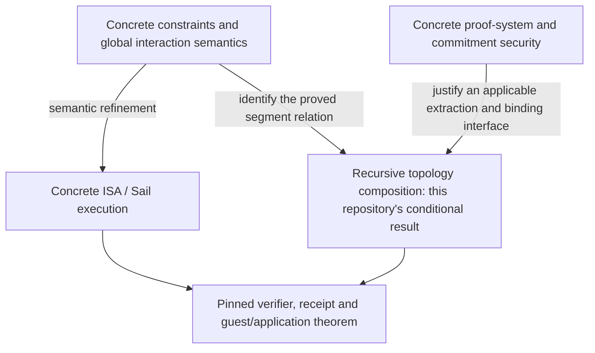

# Scope and refinement boundaries

v1 proves a conditional trace-composition theorem for the defined VanillaVM
abstraction of a zero-knowledge virtual machine (zkVM). The
[proof map](PROOF_MAP.md) identifies its conclusion and every
primitive premise. The [model-to-reality ledger](CORRESPONDENCE.md#model-to-reality-ledger)
distinguishes the paper's abstractions from Lean's additional idealizations and
states the missing concrete obligations. The later paper-to-Lean matrix locates
the formalized items in the reference paper.

An instruction-set architecture (ISA) specifies the machine's operations and
their effect on state. Sail is a language for executable ISA specifications;
matching a selected RISC-V Sail model would require a separate refinement proof.
A succinct non-interactive argument of knowledge (SNARK) provides short proofs
with a computational knowledge guarantee. This repository's perfect extraction
predicate does not itself supply that computational guarantee.

## What v1 establishes

- Within a segment, the four inner witnesses use one common bus under the
  assumed injectivity of its hash.
- The deferred bus checks imply code-selected committed ISA operations.
- Convert/combine/embed relations compose accepted leaf proofs through shared
  boundaries. Child counts strictly decrease, so the proof covers finite
  binary trees, including unbalanced trees.
- Memory reconstruction propagates the commitment invariant, including writes.
  Terminal commitment equality yields **full** terminal-memory equality under
  completeness and position binding.
- The assembly derives leaf extraction from the bus theorem and obtains CTE for
  the same configured ISA and memory representation.

## Abstractions and omitted obligations

| Area | Current model | Needed for a concrete end-to-end claim |
|---|---|---|
| Instructions | Five classes; `Word := ℕ`; `ℕ → Word` registers; arbitrary non-memory predicates and address/value conversions | Concrete word/register/memory encodings, decoding and opcode coverage; trace refinement to the selected Sail profile |
| Hash/range operations | Configured predicates, with chip routing and a binary-decomposition proof | Correctness of actual permutations/range constraints, constants and encodings |
| Segment bus | Three lists, membership and universal validity; extra valid entries are allowed | Concrete interaction messages, multiplicities, ordering, program/memory history, and lookup-argument semantics/security |
| Proof systems | Proof types and `Prop` verifiers; unrestricted total extractors | Concrete algorithms, transcript/key/statement binding, and an applicable extraction experiment with resource/error bounds |
| Memory commitments | Perfect honest-opening completeness, position binding and shared-opening update binding | Actual encoded commitment scheme, computational binding reductions, honest update-generation correctness and terminal binding error accounting |
| Recursion | Fixed positive leaf length; `n ∣ T` and `T ≥ 2n`; qualitative tree composition | Actual recursive verifier circuits, padding/length conventions, efficient extraction and quantitative composition under the selected oracle model |
| Execution endpoints | Full mathematical start/end states; fixed `T` ordinary transitions | Public receipt/input/output encoding, boot invariants, halt/trap behavior, program and verification-key identity |
| Private input | Generic wrapper completes the base statement; extraction recovers a private input | The application's allowed hint/input policy and its validation; a separate privacy theorem if needed |
| Completeness | Some accepting sanity models; no prover or end-to-end completeness property | Every allowed valid execution yields correctly generated witnesses and accepted final proofs |
| Zero knowledge | No simulation or indistinguishability property | A privacy theorem for the concrete proof system and public schema |
| Implementation | No Rust constraint extraction or executable-verifier correspondence | Pinned implementation versions and proved correspondence, or an explicitly justified trusted frontend |

Commitment `Complete` authenticates honest openings. It does not imply that the
same opening can verify both sides of an honest changed write, or that a valid
execution can be proved. The current binding and extraction premises are
soundness-side implications.

The [computability inventory](COMPUTABILITY.md) separately classifies all source
modules: a mathematical function need not be executable, and a `Prop` verifier
need not have an effective decision procedure. It also identifies the three
explicit `noncomputable` reconstruction definitions and the constructive
composition around them.

## What can be refined, and what cannot be obtained just by instantiation

Concrete instruction/precompile semantics, finite encodings and implementation
bridges can be developed around the architecture. Their correctness must be
proved; naming a predicate `hash` or a class `arith` does not supply it.
Global buses, variable-length/padded executions and practical public statements
may also require changes to the modeled relations.

Two stronger claims cannot be obtained merely by instantiating the current
theorem:

1. **Perfect binding of finite compressing commitments.** Memory completeness
   plus position binding implies injectivity on all full-memory maps
   (`mem_eq_of_commit_eq`). A smaller finite commitment space cannot encode a
   larger memory space injectively. Likewise, global injectivity of the bus hash
   cannot map all unbounded lists into a finite digest. Concrete cryptography
   requires computational/error-aware properties, not an instance claiming
   these perfect premises.
2. **Efficient extraction or a security level from a resource-free theorem.**
   `KnowledgeSound` and CTE place no computational bound on the witness
   functions. Classical choice is permitted, and final memory-witness selection
   is noncomputable. Probabilities, finite representations and executable
   reductions need a different security interface and additional theorems.

This is not a claim that the project can never model cryptography or RISC-V.
It distinguishes ordinary refinement from changing an idealized definition.
The bridge from concrete inner SNARK extraction to recursive composition
also remains a research obligation: arbitrary recursive relations querying
the same random oracle are not supported by a general relativized succinct
argument theorem in the random-oracle model (ROM), where algorithms have access
to an ideal random function. The
[known impossibility](https://eprint.iacr.org/2024/728) rules out that general
route, not every recursive proof construction. Any proposed bridge must state
its specific construction, oracle/extractor access, conditioning, errors and
runtime rather than silently translating ROM knowledge soundness into the
current predicate. See [IDEALIZATION.md](../IDEALIZATION.md).

## Obligations for end-to-end verification

The relevant layers can be developed separately:

This is an obligation map, not a completed integration graph. Its arrows denote
proofs that must be supplied for the chosen machine and proof system:

- Show that the concrete constraints, including global interactions, imply the
  selected ISA execution relation and the segment relation used here.
- Establish extraction and binding guarantees under a stated security model;
  connect them to a composition theorem with compatible premises.
- Show that the deployed verifier and public receipt implement the modeled
  verifier and endpoints, with the intended program and verification key.

Per-instruction correctness does not itself prove recursive leaf composition or
reconstruct a complete accepted execution across continuations. `MultiStep`
addresses that composition layer conditionally; it does not discharge the
constraint-to-ISA or deployed-verifier correspondence obligations.

A concrete security estimate needs explicit error and runtime bounds for the
proof system, commitments and composition. A tool such as
[soundcalc](https://github.com/ethereum/soundcalc) may support that calculation,
but v1 has no advantage/runtime theorem into which such an estimate can be
substituted. Neither external tooling nor another development's proof status is
a premise of the theorem documented here.
